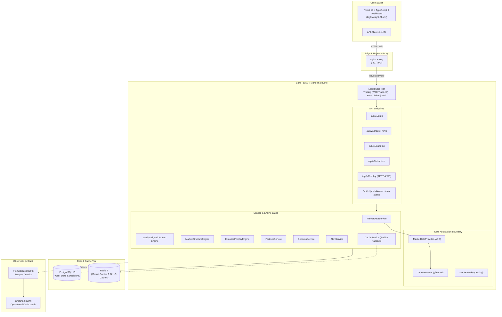
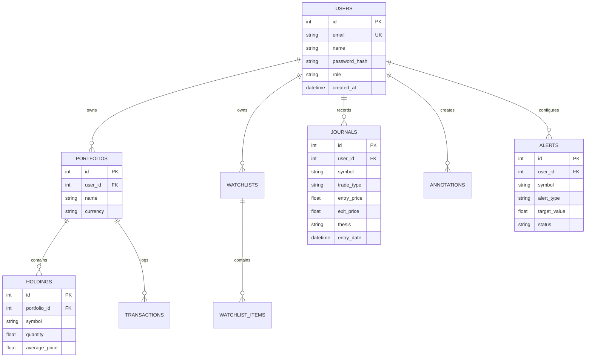

# Xeroww

> **Deterministic Financial Intelligence & Market Structure Platform**
>
> *"Do not predict what the market will do. Help the user understand what the market has already done, what conditions currently exist, and how those conditions relate to their own decisions."*

[](https://github.com/paramdesai24/Xeroww/actions/workflows/ci.yml)
[](https://fastapi.tiangolo.com)
[](https://react.dev)
[](https://www.typescriptlang.org)
[](https://www.postgresql.org)
[](https://redis.io)
[](https://www.docker.com)
[](https://prometheus.io)

---

## Table of Contents

1. [Executive Summary & Philosophy](#1-executive-summary--philosophy)
2. [System Architecture](#2-system-architecture)
3. [Technology Stack](#3-technology-stack)
4. [Key Engineering Principles](#4-key-engineering-principles)
5. [Core Features & Market Engines](#5-core-features--market-engines)
6. [API Design & Error Contracts](#6-api-design--error-contracts)
7. [Data Layer & Database Schemas](#7-data-layer--database-schemas)
8. [Security & Multi-Tenancy Architecture](#8-security--multi-tenancy-architecture)
9. [Caching & Performance Boundary](#9-caching--performance-boundary)
10. [Observability & Telemetry](#10-observability--telemetry)
11. [Local Development Quickstart](#11-local-development-quickstart)
12. [Deterministic Demo Seeding](#12-deterministic-demo-seeding)
13. [Testing Strategy & Resilience](#13-testing-strategy--resilience)
14. [Architecture Decision Records (ADRs)](#14-architecture-decision-records-adrs)
15. [Roadmap: Distributed Architecture](#15-roadmap-distributed-architecture)

---

## 1. Executive Summary & Philosophy

Xeroww is a deterministic financial intelligence and decision-support platform. The current product combines the immutable Decision Workbench with an authenticated Replay and Behaviour Lab and point-in-time Portfolio Intelligence. The platform explains observed conditions, process quality, portfolio performance, attribution, and risk without issuing predictions or trade recommendations.

### Current capabilities

- Persisted Replay Lab sessions with a server-owned candle cursor and a mandatory decision gate.
- One-candle progression, conservative execution rules, append-only events, process scoring, and private behaviour observations.
- Compact replay screens for setup, practice, review, and cross-session descriptive analytics.
- Immutable portfolio valuation snapshots with NIFTY 50 benchmark context and formula provenance.
- Performance, drawdown, attribution, covariance, correlation, beta, risk contribution, and concentration analysis.
- Pre-decision portfolio impact warnings that remain advisory and are stored with the immutable decision ticket.

### Core Philosophy
- **Deterministic Analytics Only**: Zero machine learning hallucinations, zero black-box "confidence scores", and zero automated trade recommendations. Financial decisions belong to human intelligence; mathematical market conditions belong to Xeroww.
- **Auditable & Point-in-Time Accurate**: Replay simulations and analytics strictly prevent look-ahead bias. Historical states are mathematically reproducible.
- **Future Extension Seams**: Provider and event-bus interfaces identify future integration points. Kafka, Spark, Iceberg, and network streaming are not part of the current runtime.

---

## 2. System Architecture

Xeroww enforces a unidirectional layered design:
`Routes -> Services / Analytics Engines -> Provider / Repositories -> Storage / External Upstreams`



---

## 3. Technology Stack

| Layer | Component | Version / Library | Purpose |
|---|---|---|---|
| **Frontend** | React & TypeScript | React 19.2, TypeScript 6.0, Vite 8.2 | High-performance SPA with institutional black terminal aesthetic |
| | Charting Engine | TradingView Lightweight Charts 4.1 | Hardware-accelerated financial candlestick and line charts |
| | Styling | Vanilla CSS + Tailwind | Zero-runtime CSS design tokens and dark institutional themes |
| **Backend** | API Framework | FastAPI (ASGI / Uvicorn) | Asynchronous HTTP endpoints |
| | Validation | Pydantic v2 | Strict schema validation, serialisation, and OpenAPI specs |
| | Security | PyJWT, Passlib (Bcrypt) | Cryptographic bearer tokens, Argon2/Bcrypt password hashing |
| **Persistence** | Relational Store | PostgreSQL 16 / SQLAlchemy 2.0 | ACID-compliant storage for users, portfolios, decisions, and alerts |
| | Distributed Cache | Redis 7 (`redis-py`) | Multi-tier TTL caching for high-frequency market quotes and OHLC |
| **Observability**| Metrics | Prometheus Client 0.20 | Custom counters, latency histograms, and cache hit/miss gauges |
| | Visualization | Grafana 10.3 | Provisioned dashboards monitoring throughput, errors, and P95 latency |
| | Tracing | Custom W3C Trace Middleware | `X-Trace-ID` and `X-Span-ID` request journey propagation |
| **DevOps** | Containerization | Docker Engine, Compose v2 | Multi-stage production container builds with automated healthchecks |
| | Web Server | Nginx Alpine | Reverse proxy and static asset delivery |
| | CI Pipeline | GitHub Actions | Automated linting, type-checking, matrix testing, and build validation |

---

## 4. Key Engineering Principles

1. **Deterministic Analytics**: Every calculation (Marubozu, Swing Pivots, VWAP, EMA) is a pure mathematical function of input OHLCV bars. No random seeds, stochastic approximations, or opaque scoring.
2. **Strict Provider Abstraction**: Upstream data vendor libraries (e.g., `yfinance`) are restricted solely to `api/services/yahoo_provider.py`. The rest of the platform interacts exclusively with the abstract `MarketDataProvider`.
3. **Separation of Market & User Data**: Public time-series market data is transiently cached and never mixed with private, tenant-isolated relational records (portfolios, decisions, watchlists).
4. **Zero Look-Ahead Bias**: Historical simulation strictly isolates time `t`. At candle index `k`, all calculators only have visibility over indices `0` through `k`.
5. **Fail-Safe Graceful Degradation**: If external caches (Redis) or metric collectors encounter failures, the core application falls back to local in-process mechanisms without service interruption.

---

## 5. Core Features & Market Engines

### 5.1 Historical Market Replay Engine
- **Point-in-Time Stepping**: Step forward or backward through historical trading sessions bar by bar.
- **Client-Timed Playback**: The dashboard advances through REST replay snapshots at configurable speeds (1x, 5x, 10x). No WebSocket replay endpoint is currently deployed.
- **Synchronized Context**: At every tick, indicators, volume profiles, detected patterns, and alert conditions recalculate strictly up to that point.

### 5.2 Varsity-aligned Pattern Engine (Zerodha Varsity Standards)
Detects classic Japanese candlestick formations with strict mathematical thresholds:
- **Single-Candle**: Bullish Marubozu, Bearish Marubozu, Doji, Spinning Top, Hammer, Hanging Man.
- **Multi-Candle**: Bullish & Bearish Engulfing, Bullish & Bearish Harami, Morning Star, Evening Star.
- Provides actionable structural context: Stop-loss levels, trigger candle ranges, confirmation requirements, and body/wick ratios.

### 5.3 Market Structure Engine
- **Fractal Swing Detection**: Deterministic identification of local Highs/Lows using swing pivot logic.
- **Trend Categorization**: Mathematical identification of Higher Highs (HH), Higher Lows (HL), Lower Highs (LH), and Lower Lows (LL).
- **Support & Resistance Clusters**: Density-based clustering of historical swing levels with strength weighting.
- **Breakout & Breakdown Detection**: Close-confirmed violations of validated structural levels.

### 5.4 Signal Alignment
- Computes deterministic alignment from the configured daily candle series.
- Multi-timeframe confluence is a future capability and is not calculated by the current runtime.

### 5.5 Decision Workbench and Portfolio Tracking
- **Holdings & P&L**: Average price calculation, realized/unrealized profit calculation, and asset allocation breakdown.
- **Immutable Decision Tickets**: Capture direction, intent, holding period, setup, invalidation, targets, confidence, and rationale as a structured record.
- **Server-Authoritative Evidence Snapshot**: Freeze point-in-time analytics, market structure, patterns, provenance, and data-quality context when a ticket is submitted.
- **Transparent Risk Preview**: Show cash-risk, allocation, and quantity constraints with the exact limiting formula before submission.
- **Append-Only Amendments**: Preserve the original thesis while recording notes, invalidation changes, target changes, and status transitions.
- **Cross-Page Workflow**: Move from market or replay context into `/decisions/new`, then review the saved record at `/decisions/{id}`.
- **NIFTY 50 Symbol Search**: Search the supported company universe by ticker or company name, with prefix matches ranked before contains matches.
- **Chart Annotations**: Anchor analytical notes, horizontal price levels, and trade tags directly to price coordinates.
- **Structural Alerts**: Price-threshold and pattern-formation triggers evaluated against live or replayed market events.

---

## 6. API Design & Error Contracts

The API exposes HTTP routes at the application root. Deployment proxies may add an `/api` prefix. There are no deployed WebSocket channels in the current release.

### Standardized Error Envelope
Xeroww guarantees consistent error envelopes across all HTTP 4xx/5xx responses:

```json
{
  "error": {
    "code": "RESOURCE_NOT_FOUND",
    "message": "Portfolio with ID 42 was not found or access is denied.",
    "details": {
      "resource_type": "portfolio",
      "resource_id": 42
    }
  },
  "timestamp": "2026-09-07T00:30:00Z",
  "request_id": "0191c78a-350e-7d6f-801a-cf2a9bb4c1a2"
}
```

### Key API Routes
| Method | Path | Description | Auth Required |
|---|---|---|---|
| `POST` | `/auth/register` | Create user account | No |
| `POST` | `/auth/login` | Obtain JWT access token | No |
| `POST` | `/auth/logout` | Revoke active JWT token | Yes |
| `GET` | `/quote/{symbol}` | Near real-time market quote | No |
| `GET` | `/ohlc/{symbol}` | Historical OHLCV candle series | No |
| `GET` | `/patterns/{symbol}` | Varsity-aligned Pattern Engine scan | No |
| `GET` | `/market-structure/{symbol}` | Swings, trends, and support/resistance | No |
| `GET` | `/replay/{symbol}/timeline` | Load a historical replay timeline | No |
| `GET` | `/replay/{symbol}/step/{step}` | Retrieve a point-in-time replay snapshot | No |
| `GET` | `/portfolios` | List user portfolios | Yes |
| `POST` | `/decisions/preview` | Preview evidence and risk for a draft ticket | Yes |
| `POST` | `/decisions` | Submit an immutable decision ticket | Yes |
| `GET` | `/decisions` | List the current user's decision tickets | Yes |
| `GET` | `/decisions/{id}` | Read a ticket, snapshot, and amendment history | Yes |
| `POST` | `/decisions/{id}/amendments` | Append a ticket amendment | Yes |
| `POST` | `/decisions/{id}/status` | Append a status transition | Yes |
| `POST` | `/alerts` | Create price or pattern alert | Yes |
| `GET` | `/metrics` | Prometheus metrics scrape endpoint | No |
| `GET` | `/health` | Deep healthcheck (DB, Cache, Provider) | No |

---

## 7. Data Layer & Database Schemas

User state is modeled via SQLAlchemy 2.0 with strict relational integrity:



---

## 8. Security & Multi-Tenancy Architecture

- **Stateless Bearer Authentication**: High-security HMAC-SHA256 JWT tokens with configurable TTL (default 60 minutes).
- **Token Revocation Blacklist**: Explicit logout via `/api/v1/auth/logout` places the active token JTI in the distributed blacklist until natural expiration.
- **Tenant Isolation (OWASP BOLA Protection)**: All mutating and querying operations against user-owned resources enforce ownership filters:
  ```python
  query = db.query(Portfolio).filter(Portfolio.id == portfolio_id, Portfolio.user_id == current_user.id)
  ```
  Attempting to inspect or modify another tenant's resource raises `404 Not Found` rather than leaking resource existence.
- **Rate Limiting**: Sliding-window rate limiter enforcing:
  - **Unauthenticated requests**: 60 requests per minute per client IP.
  - **Authenticated requests**: 180 requests per minute per user ID.
  Violations receive `429 Too Many Requests` with a standard `Retry-After: 60` header.

---

## 9. Caching & Performance Boundary

To insulate upstream market APIs from high-frequency queries and optimize P95 latencies:

- **Redis Caching Tier**: Caches market quotes (5–15s TTL) and OHLC historical bars (60–3600s TTL).
- **Graceful In-Memory Fallback**: If Redis becomes unreachable, `CacheService` seamlessly transitions to a local in-process LRU cache. Zero HTTP 500 errors are returned to the user.
- **Standardized Key Namespaces**:
  - `quote:{symbol}`
  - `ohlc:{symbol}:{timeframe}:{start}:{end}`
  - `blacklist:{token_jti}`

---

## 10. Observability & Telemetry

### Prometheus Metrics (`/metrics`)
- `http_requests_total{method, endpoint, status_code}`: Total API request volume.
- `http_request_duration_seconds{method, endpoint}`: Request latency histogram (P50, P90, P99).
- `market_provider_requests_total{provider, status}`: Upstream market API calls.
- `market_provider_latency_seconds{provider}`: Upstream latency distribution.
- `cache_operations_total{operation, status}`: Redis/In-Memory hit vs. miss counters.
- `active_replay_sessions`: Current concurrent historical replay sessions.

### OpenTelemetry-Compatible Tracing
Every request journey is assigned:
- `X-Trace-ID`: 32-character hexadecimal identifier.
- `X-Span-ID`: 16-character hexadecimal span identifier.
Internal methods profile execution with the `trace_span("operation_name")` context manager.

### Grafana Operational Dashboard
Pre-configured dashboard provisioned automatically in `docker-compose`:
- **Throughput**: Real-time requests per second.
- **Error Budget**: HTTP 4xx and 5xx rates.
- **Latencies**: P50, P95, and P99 service response times.
- **Cache Hit Ratio**: Effectiveness of Redis caching tier.

---

## 11. Local Development Quickstart

### Option A: Complete Docker Compose Environment (Recommended)

Starts PostgreSQL, Redis, FastAPI Backend, React Frontend, Nginx, Prometheus, and Grafana:

```bash
# 1. Clone the repository
git clone https://github.com/paramdesai24/Xeroww.git
cd Xeroww

# 2. Configure environment variables
cp .env.example .env
# Replace all development passwords and JWT secrets before any shared deployment.

# 3. Build and run containers
make docker-up
# or: docker compose up -d --build
```

Access services:
- **Terminal UI**: [http://localhost:5173](http://localhost:5173) (or via Nginx on [http://localhost](http://localhost))
- **FastAPI OpenAPI Docs**: [http://localhost:8000/docs](http://localhost:8000/docs)
- **Prometheus Metrics**: [http://localhost:9090](http://localhost:9090)
- **Grafana Dashboard**: [http://localhost:3000](http://localhost:3000) (Default user: `admin` / `admin`)

To shut down:
```bash
make docker-down
```

---

### Option B: Native Host Execution

#### 1. Backend Setup
```bash
# Setup Python virtual environment
python -m venv api/venv
# On Windows:
.\api\venv\Scripts\activate
# On Linux/macOS:
# source api/venv/bin/activate

# Install dependencies
pip install -r api/requirements.txt

# Apply the current schema. SQLite is used unless DATABASE_URL is set.
alembic upgrade head

# Run deterministic demo data seed
python api/scripts/seed_demo_data.py

# Start FastAPI development server
uvicorn api.main:app --reload --port 8000
```

#### 2. Frontend Setup
```bash
# Open a new terminal and navigate to dashboard
cd dashboard

# Install dependencies
npm install

# Start Vite development server
npm run dev
```

---

## 12. Deterministic Demo Seeding

The platform includes a zero-dependency deterministic database seeder:

```bash
make seed
# or: python api/scripts/seed_demo_data.py
```

### Pre-Configured Test Accounts:
- **Demo Trader**:
  - Email: `trader@xeroww.internal`
  - Password: `Trader123!`
  - Pre-seeded with: Watchlists, RELIANCE holding, decision journal entries, chart annotations, and active alerts.
- **Administrator**:
  - Email: `admin@xeroww.internal`
  - Password: `Admin123!`
  - Role: `admin`

---

## 13. Testing Strategy & Resilience

Xeroww maintains comprehensive automated test suites covering happy paths, edge cases, failure injection, and security constraints.

```bash
# Run complete test suite with coverage
make test
# or: pytest api/tests -v
```

### Test Coverage Summary
- **Pattern Engine Tests** (`test_patterns.py`, `test_market_structure.py`): Validates Marubozu, Engulfing, Harami, Stars, and Doji against textbook definitions.
- **Replay Engine Tests** (`test_replay_service.py`): Verifies bar-by-bar progression, state isolation, and zero look-ahead bias.
- **Security & Multi-Tenancy Tests** (`test_authorization_security.py`): Verifies cross-tenant isolation, IDOR prevention, and token blacklist revocation.
- **Rate Limiter Tests** (`test_rate_limiting.py`): Confirms 429 throttling and `Retry-After` headers.
- **Resilience & Fallback Tests** (`test_resilience_and_failures.py`, `test_cache_service.py`): Confirms system survival when Redis disconnects or upstream providers return empty/malformed data.

---

## 14. Architecture Decision Records (ADRs)

Key architectural decisions are documented under [`docs/adr/`](docs/adr/):

- [ADR 0001: Market Data Provider Abstraction](docs/adr/0001-provider-abstraction.md)
- [ADR 0002: Separation of Market Data and User State](docs/adr/0002-market-user-data-separation.md)
- [ADR 0003: Deterministic Financial Analytics Architecture](docs/adr/0003-deterministic-analytics.md)
- [ADR 0004: Historical Market Replay Engine Design](docs/adr/0004-replay-design.md)
- [ADR 0005: Multi-Tiered Caching Strategy & Redis Fallback](docs/adr/0005-caching-strategy.md)
- [ADR 0006: Observability, Metrics & Tracing Foundation](docs/adr/0006-observability-strategy.md)

---

## 15. Roadmap: Distributed Architecture

Xeroww is a modular monolith. Distributed streaming remains a proposed future direction and is not deployed today.

```text
Current Runtime:
Market Provider ──> CacheService / In-Memory ──> Service Calculators ──> FastAPI ──> Client

Distributed Target:
Market Provider ──> Kafka Ingestion Pipeline
                         │
                         ├──> Apache Spark Streaming (Real-time Candle & Structure Windows)
                         │         │
                         │         └──> Apache Iceberg / ClickHouse (Analytical Parquet Lakehouse)
                         │
                         └──> WebSocket Event Dispatcher ──> Client Terminals
```

### Planned Distributed Architecture Milestones:
1. **Kafka Market Ingestion**: Ingest live order book ticks and trade prints into distributed partitioned Kafka topics.
2. **Spark Structured Streaming**: Shift multi-timeframe rolling aggregations and fractal swing detection into cluster computing jobs.
3. **Analytical Lakehouse Storage**: Store multi-year tick history in Apache Iceberg on object storage for ultra-fast point-in-time backtesting.
4. **Broker Execution Connectors**: Pluggable order execution adapters (Zerodha Kite, Interactive Brokers) for direct order submission from the terminal.

---

## License

MIT © 2026 Xeroww Platform Authors. Built for disciplined, institutional-grade market intelligence.
