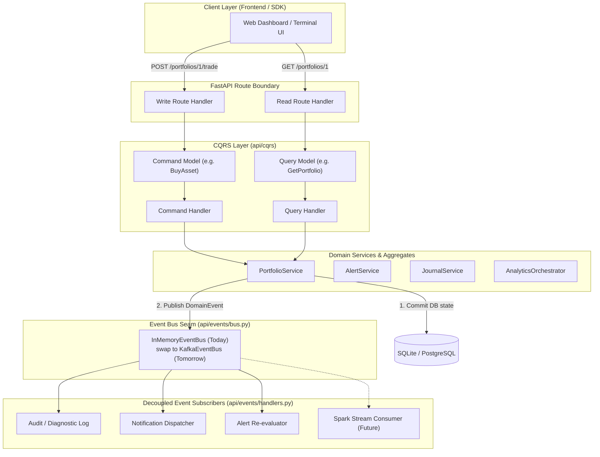
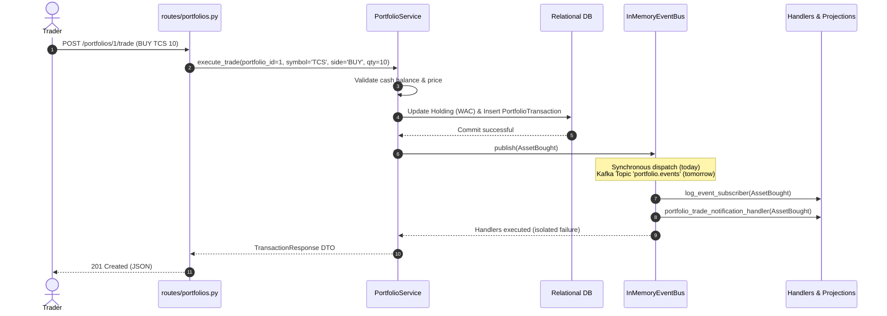
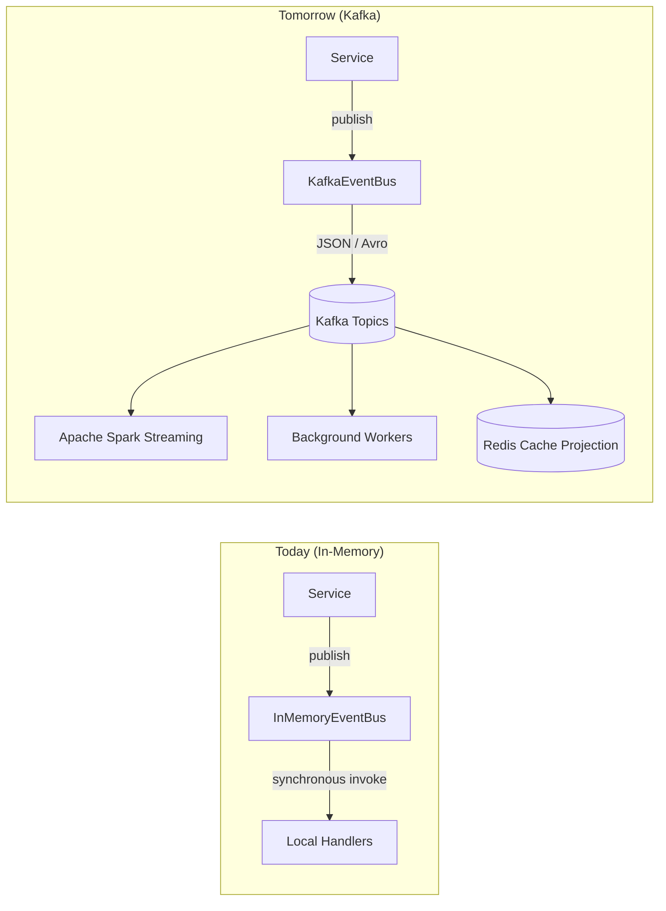

# Domain Events and CQRS Preparation

> Current-state boundary: V0.11 uses a synchronous in-memory domain event bus. Routes call services directly. Replay sessions also persist their own append-only audit events in PostgreSQL or SQLite. The CQRS package contains preparation interfaces and is not the active request dispatch path. There is no Kafka transport or Spark runtime. Sections describing those systems are target-state proposals.

Replay durable events are the authoritative session audit trail. Bounded integration events are published only after successful commits for diagnostics and future transport integration. Portfolio snapshot and risk policy changes follow the same post-commit publication rule. Free-text reflections and full analytical matrices are never copied into integration event payloads.

## 1. Architectural Vision & Purpose

Xeroww is designed around a **clean, decoupled, event-driven foundation**.

Today, services communicate through local in-memory invocations and synchronous bus dispatch.  
Tomorrow, as institutional volume scales, Kafka and Apache Spark will become drop-in replacements for the event transport and streaming analytics layers.

Domain events and CQRS interfaces establish useful seams, but a distributed migration will still require transport, delivery, idempotency, schema, operations, and integration work.

---

## 2. Architecture Overview

### 2.1 CQRS and Event Flow



---

## 3. End-to-End Event Lifecycle: Simulated Paper Trade

Below illustrates what happens when a user executes a `BuyAsset` command:



---

## 4. Domain Event Taxonomy

Every domain event derives from `DomainEvent` in `api/events/base.py`:

```python
@dataclass(frozen=True)
class DomainEvent:
    event_id: str          # UUID4 for idempotency and deduplication
    event_type: str        # Dot-notated namespace, e.g. 'portfolio.asset_bought'
    occurred_at: datetime  # UTC ISO timestamp of occurrence
    aggregate_id: str      # Qualified entity ID, e.g. 'portfolio:42'
    version: int           # Payload schema version (starts at 1)
    payload: dict          # State delta and event specifics
    metadata: dict         # user_id, correlation_id, causation_id, trace context
```

### 4.1 Event Catalog

| Aggregate | Event Type | Class Name | Payload Attributes | Trigger / Source |
|---|---|---|---|---|
| `portfolio:{id}` | `portfolio.created` | `PortfolioCreated` | `portfolio_id`, `name`, `user_id`, `initial_cash` | Portfolio factory |
| `portfolio:{id}` | `portfolio.asset_bought` | `AssetBought` | `portfolio_id`, `symbol`, `quantity`, `price`, `total_cost`, `user_id` | `_execute_buy` |
| `portfolio:{id}` | `portfolio.asset_sold` | `AssetSold` | `portfolio_id`, `symbol`, `quantity`, `price`, `proceeds`, `realized_pnl`, `user_id` | `_execute_sell` |
| `portfolio:{id}` | `portfolio.updated` | `PortfolioUpdated` | `portfolio_id`, `cash_balance`, `user_id`, `reason` | Balance reconciliation |
| `alert:{id}` | `alert.created` | `AlertCreated` | `alert_id`, `symbol`, `alert_type`, `condition_payload`, `user_id` | `create_alert` |
| `alert:{id}` | `alert.triggered` | `AlertTriggered` | `alert_id`, `symbol`, `alert_type`, `trigger_price`, `reason`, `user_id` | `evaluate_alert` |
| `alert:{id}` | `alert.evaluated` | `AlertEvaluated` | `alert_id`, `symbol`, `triggered`, `current_price`, `user_id` | Evaluation pass |
| `alert:{id}` | `alert.deleted` | `AlertDeleted` | `alert_id`, `user_id` | `delete_alert` |
| `journal:{id}` | `journal.entry_created` | `JournalEntryCreated` | `entry_id`, `symbol`, `user_id`, `thesis`, `entry_type`, `confidence` | `create_entry` |
| `journal:{id}` | `journal.entry_reviewed` | `JournalEntryReviewed` | `entry_id`, `symbol`, `user_id`, `outcome`, `audit_score`, `review_notes` | `review_entry` |
| `journal:{id}` | `journal.entry_updated` | `JournalEntryUpdated` | `entry_id`, `user_id`, `updated_fields` | `update_entry` |
| `symbol:{ticker}` | `market.snapshot_received` | `MarketSnapshotReceived` | `symbol`, `price`, `volume`, `timestamp`, `change`, `change_pct` | Market data ingest |
| `symbol:{ticker}` | `market.pattern_detected` | `PatternDetected` | `symbol`, `pattern_name`, `confidence`, `direction`, `candle_index` | `PatternService` / `orchestrator.run_patterns` |
| `symbol:{ticker}` | `market.regime_changed` | `RegimeChanged` | `symbol`, `old_regime`, `new_regime`, `confidence` | `StructureService` / `orchestrator.run_market_regime` |
| `symbol:{ticker}` | `market.support_resistance_broken` | `SupportResistanceBroken` | `symbol`, `level`, `level_type`, `break_price`, `direction` | S/R break detector |

---

## 5. CQRS Model Separation

Commands and Queries live in `api/cqrs/`:

```
api/cqrs/
├── __init__.py        # Re-exports all Commands, Queries, and Protocols
├── commands.py        # Mutating commands: BuyAsset, SellAsset, CreateAlert, etc.
├── queries.py         # Read queries: GetPortfolio, GetReplayState, GetMarketSnapshot, etc.
└── handlers.py        # CommandHandler, QueryHandler, CommandBus, QueryBus protocols
```

### Rule of thumb:
- **Commands**: Named with imperative verbs (`BuyAsset`, `CreatePortfolio`). Always carry side-effects. Always result in state change and optional Domain Events. Never return entity representations beyond confirmation/IDs.
- **Queries**: Named with getter nouns (`GetPortfolio`, `GetMarketSnapshot`). Strictly read-only with zero side-effects. Can be routed to read-replicas, caching layers, or Elasticsearch indices.

---

## 6. Migration Recipe: Transitioning to Apache Kafka

When moving from local development to production with Apache Kafka:



### The 3-Step Kafka Replacement:

1. **Implement `KafkaEventBus(EventBus)`**:
   ```python
   class KafkaEventBus(EventBus):
       def __init__(self, bootstrap_servers: str, producer):
           self.producer = producer

       def publish(self, event: DomainEvent) -> None:
           topic = f"xeroww.{event.event_type.split('.')[0]}.events"
           self.producer.send(topic, key=event.aggregate_id, value=event.to_dict())
   ```
2. **Inject via `set_event_bus()`**:
   In `api/main.py`:
   ```python
   # Replace get_event_bus() singleton with KafkaEventBus:
   set_event_bus(KafkaEventBus(bootstrap_servers=settings.KAFKA_SERVERS))
   ```
3. **Zero Changes to Domain Services**:
   - `PortfolioService`, `AlertService`, `JournalService`, and `AnalyticsOrchestrator` continue to call `get_event_bus().publish(...)` without modifying a single line of business logic.
